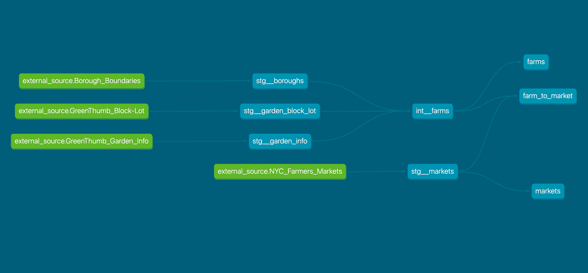

# Analytics Exchange Learning Summit 2024

This is a demonstration of how New York City employees can use [DuckDB](https://duckdb.org/) and [dbt](https://docs.getdbt.com/) to build and analyze data.

This repo was created to accompany a presentation for Analytics Exchange Summit 2024 [[Google Slides](https://docs.google.com/presentation/d/1477Mqcn3IihMbOh_RuUPdZTqoX6RJTj7oExXVRfAqxs/edit?usp=sharing)].

A fictional dataset about local agriculture called `Farm to Market` was created for the purposes of this repo.

The code is organized into stages to show a progression from simple queries to a robust data pipeline.

- Stage 0: confirm everything is setup correctly
- Stage 1: load and explore data
- Stage 2: use a data pipeline to build Farm to Market
- Stage 3: use dbt to build Farm to Market

## Farm to Market

### Dataset description

Farm to Market captures where local food is sold and might be grown in New York City.

This dataset combines the locations of farmers markets and potential farms (community gardens) to highlight availability and potential local suppliers of healthy produce in NYC.

### Final tables

`markets`

Each row is a farmers market

`farms`

Each row is a potential farm

`farm_to_market`

Each row is a market and farm pair

### Source data

Source data:

- NYC Borough Boundaries [[source](https://data.cityofnewyork.us/City-Government/Borough-Boundaries/tqmj-j8zm)]
- NYC Farmers Markets [[source](https://data.cityofnewyork.us/Health/NYC-Farmers-Markets/8vwk-6iz2/about_data)]
- GreenThumb Garden Info [[source](https://data.cityofnewyork.us/dataset/GreenThumb-Garden-Info/p78i-pat6/about_data)]
- GreenThumb Block-Lot [[source](https://data.cityofnewyork.us/dataset/GreenThumb-Block-Lot/fsjc-9fyh/about_data)]

### Graph of dbt data pipleline



## Setup

### Prerequisites

> [!IMPORTANT]
> For City employees, installing software on work computers can be difficult due to a lack of administrative access. But you may be able to install software "only for me" rather than "anyone who uses this computer".
>
> All of these prerequisites can be (and by default are) installed only for the user rather than system-wide.

Required

- [Python 3.12](https://www.python.org/downloads/release/python-3120/) for running python code (any version >=3.9 works)
- [git](https://git-scm.com/downloads) for cloning this repo and installing `bash` terminal

Optional

- [VS Code](https://code.visualstudio.com/) for an integrated development environment (IDE) and the Python extension
- [DBeaver](https://dbeaver.io/) for querying a database
- [uv](https://docs.astral.sh/uv/) to manage python versions

> [!TIP]
> To install `uv` on a NYC City employee Windows PC may require the following powershell commands instead of what `uv` docs say:
> 
>     Set-ExecutionPolicy -ExecutionPolicy RemoteSigned -Scope CurrentUser
>     irm https://astral.sh/uv/install.ps1 -OutFile install-uv.ps1
>     iex .\install-uv.ps1

### Environment

> [!IMPORTANT]
> For City employees, most work computers access the internet through a firewall. This causes issues when writing and running code (e.g. `pip install` fails).
>
> To allow code to access the internet on a PC:
>
> 1. Search for and select `Edit environment variables for your account` in the Start menu
>
> 2. Add two environment variables named `http_proxy` and `https_proxy` with the same value of `http://bcpxy.nycnet:8080`

1. Clone this repo and navigate to the new folder:

    ```bash
    git clone https://github.com/NYCPlanning/anex-summit-2024-demo.git
    cd anex-summit-2024-demo
    ```

2. Create a python virtual environment named `.venv` either using the command below or using the VS Code command `Python: create environment`

    ```bash
    which python
    python --version
    python -m venv .venv
    ```

3. Activate the virtual environment

    <details open>
    <summary>Windows bash</summary>

    ```bash
    source .venv/Scripts/activate
    ```

    </details>

    <details>
    <summary>Windows PowerShell</summary>

    ```shell
    venv\Scripts\Activate.ps1
    ```

    </details>

    <details>
    <summary>POSIX bash/zsh</summary>

    ```shell
    source .venv/bin/activate
    ```

    </details>

4. Install packages

    ```bash
    python -m pip install --requirement requirements.txt
    pip list
    ```

## Stage 0: Sanity Check

Run a python script to confirm everything is setup

```bash
python -m stage_0.sanity_check
```

## Stage 1: Load and explore data

Load and explore data from various sources

### Source data

These datasets were chosen to show some of the ways source data can be imported with DuckDB.

- PLUTO from the NYC Department of City Planning ([source](https://data.cityofnewyork.us/d/64uk-42ks/))
- NYC Airbnb data ([source](https://insideairbnb.com/get-the-data/))
- Trip record data from the NYC Taxi and Limousine Commission (TLC) ([source](https://www.nyc.gov/site/tlc/about/tlc-trip-record-data.page))

### Steps

1. Download PLUTO from NYC Open Data [here](https://data.cityofnewyork.us/d/64uk-42ks/) by navigating to `Export` -> `Download file` -> `Export format: CSV`

> [!TIP]
> If the Open Data download takes too long, try downloading from DCP's site Bytes of the Big Apple ([link](https://www.nyc.gov/site/planning/data-maps/open-data/dwn-pluto-mappluto.page)).

2. Rename the downloaded csv file to `pluto.csv` and move it to `data/source_data/`

3. Run a python script to download the other two sources and load all three sources into a database:

   ```bash
   python -m stage_1.load
   ```

4. Use the Jupyter notebook `stage_1/explore.ipynb` or DBeaver to explore the data

## Stage 2: Pipeline

Use a data pipeline to build Farm to Market

1. Download all source data from their Open Data pages by navigating to `Export` -> `Download file`. Depending on the dataset, either download a CSV or a GeoJSON file.

2. Rename the downloaded files to remove the dates and move them to `data/source_data/`

3. Run a python script to load all source data into a database:

   ```bash
   python -m stage_2.load
   ```

4. Run python scripts to transform and export data:

   ```bash
   python -m stage_2.transform
   python -m stage_2.export
   ```

5. Use the Jupyter notebook `stage_2/analyze.ipynb` to review and analyze the dataset

## Stage 3: dbt pipeline

Use dbt to build Farm to Market

1. Download and rename source data as described in Stage 2

2. Navigate to the `stage_3` folder:

   ```bash
   cd stage_3
   ```

3. Install dbt packages and confirm setup:

   ```bash
   dbt deps
   dbt debug
   ```

4. Test source data:

   ```bash
   dbt test --select "source:*"
   ```

5. Build the dataset:

   ```bash
   dbt build
   ```

6. Generate and view data documentation:

   ```bash
   dbt docs generate
   dbt docs serve
   ```
